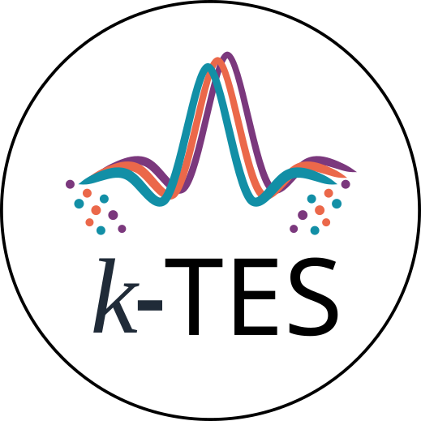

<div align="center">

  

  <h1>kTES.jl</h1>

  <p><b>k-space Tissue Ensemble Simulation</b></p>
  <p><i>Fast, physics-accurate MRI sequence simulation in Julia.</i></p>

  [](https://julialang.org)
  <!--[](https://github.com/gsahonero/kTES.jl/actions/workflows/CI.yml)-->
  [](https://opensource.org/licenses/MIT)

</div>

---

## What is k-TES?

In conventional MRI simulation, computing signals from realistic digital phantoms requires tracking millions of individual spins (isochromats) through every step of a pulse sequence. This direct approach becomes a major computational bottleneck, particularly when optimizing sequences or designing RF pulses where simulations must run repeatedly.

The **k-space Tissue Ensemble Simulation (k-TES)** method introduces an efficient way to simulate MRI signals by separating spatial geometry from spin dynamics:

1. **Group similar tissues together:** Spins across an object often share similar biophysical properties (such as $T_1$, $T_2$, and proton density $\rho$). k-TES groups these into representative **tissue ensembles**.
2. **Precompute tissues' spatial support once:** The spatial geometry of each ensemble is mapped directly to Fourier ($k$-space) coordinates using Non-Uniform Fast Fourier Transforms (FINUFFT).
3. **Simulate sequence physics quickly:** Bloch equation integration is evaluated only for the tissue-unit supports rather than every individual spatial location.
4. **Analytical intra-voxel dephasing ($T_2^*$):** k-TES naturally produces $T_2^*$ decay by setting the off-resonance distribution of isochromats within the tissue-unit support to follow a Cauchy distribution.

Because the tissues' spatial support only needs to be computed once, sequence parameters (such as flip angles, repetition times, and phase schedules) can be simulated and optimized repeatedly quickly.

While this implementation currently interfaces with [KomaMRI.jl](https://github.com/JuliaHealth/KomaMRI.jl) for sequence definitions and Bloch integration, the k-TES formulation is simulator-agnostic and designed to support different backends.

---

## Key Features

* **Substantial Speedups:** Accelerates simulation time compared to conventional Bloch solvers, specially with low-end GPUs and CPUs.
* **Analytical $T_2^*$ Inhomogeneous Dephasing:** Accurate intra-voxel decay.
* **Parameter-Space Clustering:** Compresses heterogeneous phantoms into a smaller representative tissue classes set.
* **GPU Acceleration:** Accelerated simulation on NVIDIA GPUs via [CUDA.jl](https://github.com/JuliaGPU/CUDA.jl) and [KernelAbstractions.jl](https://github.com/JuliaGPU/KernelAbstractions.jl).
* **KomaMRI Integration:** Works with KomaMRI's `Sequence`, `Scanner`, and `Phantom` representations.

---

## Installation

`kTES.jl` requires Julia 1.10 LTS or later.

In the Julia REPL, enter Pkg mode by typing `]`:

```julia
pkg> add https://github.com/gsahonero/kTES.jl.git
```

Or programmatically:

```julia
using Pkg
Pkg.add(url = "https://github.com/gsahonero/kTES.jl.git")
```

---

## Quickstart

Simulate a 2D Spoiled Gradient Echo (SPGR) acquisition of an anatomical brain phantom in just a few minutes:

```julia
using kTES

# 1. Generate an anatomical brain phantom using KomaMRI's brain_phantom2D
phantom = brain_phantom2D();

# 2. Configure acquisition parameters
sys = Scanner();

# 3. Create a Spoiled Gradient Echo (SPGR) pulse sequence
seq_params = default_SPGR_params(sys);
seq = create_GE_2D(seq_params, sys);

# 4. Simulate!
data = simulate_acquisition(phantom, seq, sys)

# 6. Display the image - we use plot_image from KomaMRI.jl and abs.() since it is a complex image.
# No explicit reconstruction is needed! The previous function takes care of that by using the inverse Fourier Transform.
display(plot_image(abs.(data[3])))
```

---

## GPU Acceleration

`kTES.jl` supports NVIDIA GPU acceleration via package extensions. To enable GPU execution, load `CUDA` alongside `kTES`:

```julia
using CUDA
using kTES
```

Check whether the GPU accelerator is active:

```julia
println("Active backend: ", active_accelerator()) # :cuda or :cpu
println("GPU active:     ", has_accelerator())     # true or false
```

---

## Experiments & Reproducibility

Reproducibility scripts and benchmarks reported in the manuscript are available in [`experiments/k-space tissue ensemble simulation/`](experiments/k-space%20tissue%20ensemble%20simulation/):

```bash
cd "experiments/k-space tissue ensemble simulation"
julia setup_and_run.jl
```

---

## Contributors

* **Guillermo Sahonero Alvarez** ([@gsahonero](https://github.com/gsahonero))
* **Ronal Coronado**
* **Carlos Castillo-Passi**
* **Pablo Irarrázaval**

---

## License

This project is licensed under the [MIT License](LICENSE).
